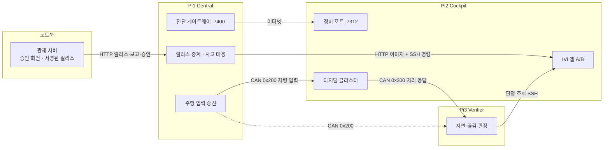
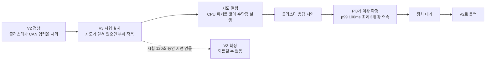
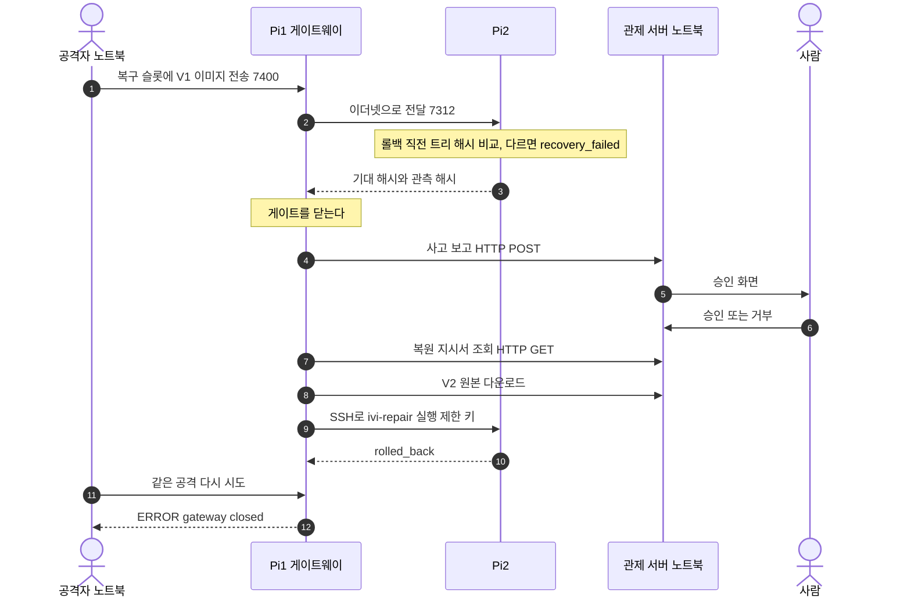

# CAPSTONE_OTA

**다중 ECU 환경에서의 OTA 소프트웨어 호환성 검증 및 자동 롤백 시스템**

[](https://github.com/jsy202/CAPSTONE_OTA/actions/workflows/tests.yml)

차량용 소프트웨어를 무선으로 갱신(OTA)했을 때, 새 앱이 **실행은 되는데 같은 보드의 다른 기능을 느리게 만드는**
문제를 잡아내 이전 버전으로 되돌리는 Raspberry Pi 3대짜리 프로젝트다. 학생 캡스톤이며 실차·양산 시스템이 아니다.

## 한눈에 보기

| | 시나리오 1: CPU 경합 | 시나리오 2: 롤백 경로 공격 |
|---|---|---|
| **상황** | 갱신한 IVI 앱이 CPU를 독점해 같은 보드의 클러스터 응답이 늦어진다 | 정비 포트로 복구 슬롯을 다른 정식 서명 릴리스로 바꿔치기한다 |
| **누가 잡나** | 별도 보드 **Pi3**가 CAN 버스에서 직접 지연을 잰다 | Pi2가 롤백 직전 슬롯의 **트리 해시**를 커밋 기록과 비교한다 |
| **그 뒤** | 정차를 기다려 **자동 롤백** | 게이트웨이가 닫히고, **사람이 관제 서버에서 승인**해야 복원 |
| **실보드** | 실제 감지·롤백 확인 | 공격 도달·차단·승인 복원·재공격 거부 확인 |

각각 실제 보드 3대에서 확인했고 모두 1회씩의 시연이다. 무엇을 하지 않았는지는 [알려진 한계](docs/KNOWN_ISSUES.md)에 있다.

## 목차

[구조](#구조) · [데이터가 오가는 길](#데이터가-오가는-길) · [시나리오 1](#시나리오-1-ivi의-cpu-경합과-자동-롤백) · [시나리오 2](#시나리오-2-롤백-경로-공격과-사람-승인-복원) · [실보드 결과](#실보드-결과) · [직접 실행](#직접-실행해-보기) · [코드 지도](#코드-지도) · [문서](#문서)

## 구조



- Raspberry Pi 3대, MCP2515 HAT, `can0` 500kbit/s. 파일은 LAN으로, 차량 입력과 처리 응답은 CAN으로 오간다.
- **갱신·롤백 대상은 IVI**다. Pi2의 IVI와 클러스터는 한 Linux 보드에서 도는 별개의 앱이며, 물리적으로 분리된 두 ECU가 아니라 통합 콕핏의 공유 자원 환경을 흉내 낸 것이다.
- **A/B는 앱 디렉터리 두 개**다. OS 파티션·커널·부트로더 OTA가 아니다.
- 릴리스는 `release.json`, `release.sig`, `app.tar.gz`. Ed25519 서명, 파일 해시, 복구 앱 트리 해시를 검사한다.

### 데이터가 오가는 길

| 무엇 | 어떻게 | 경로 |
|---|---|---|
| 이미지(릴리스) | **HTTP 직접**: Pi1이 서명을 검증·캐시한 뒤 자기 HTTP로 Pi2에 내준다. 실제 바이트가 전송된다 | 노트북 → Pi1 → Pi2 |
| 갱신·복원 **명령** | **SSH**: `ivi-update`·`ivi-repair` 실행(복원은 명령이 고정된 제한 키). 이미지는 나르지 않는다 | Pi1 → Pi2 |
| 사고 보고·승인 | **HTTP 직접**: `POST /incidents`, `GET .../order`, 결과 통보. SSH가 아니다 | Pi1 → 노트북 |
| 공격 이미지 | TCP: 게이트웨이(7400)가 받아 이더넷으로 Pi2 정비 포트(7312)에 전달 | 노트북 → Pi1 → Pi2 |
| 지연 판정 | Pi3가 CAN을 직접 수신, Pi2 감독기가 SSH로 결과 조회 | Pi3 → Pi2 |

시연에서 다운로드·설치 막대가 천천히 차는 것은 보여 주기 위해 단계를 늦춘 것(`demo_pace`)이며 전송 자체는 실제다.

## 시나리오 1: IVI의 CPU 경합과 자동 롤백



### 무엇을 어떻게 재나

| 항목 | 내용 |
|---|---|
| 입력 | Pi1의 `0x200`: 속도·RPM·기어·카운터·CRC |
| 응답 | Pi2의 `0x300`: Qt 모델 반영 직후의 속도·카운터·CRC |
| 지연 계산 | Pi3가 **자기 CAN 소켓**에서 두 프레임을 받아 같은 카운터끼리 짝지어 커널 수신 시각 차이로 계산. 보드 사이 시계 동기화나 SSH 왕복 시간은 쓰지 않는다 |
| 판정 창 | 10초 창, 5초 간격 |
| 주 기준 | **창 p99 지연 ≤ 100ms**. 어긴 상태가 같은 유형으로 3개 창 연속이면 확정(100ms는 CAN 한 주기 안에 처리한다는 개발 기준이며 업계 표준이 아님) |
| 보조 기준 | 정상 기준선 대비 p99, CUSUM, 드리프트, 응답 끊김·누락, 입력 주기 이상. 2개 이상 동시 발화와 지속을 요구한다(같은 지연 데이터에서 계산한 통계라 독립된 증거는 아님) |

측정 대상은 **클러스터 소프트웨어의 처리 응답 지연**이다. 화면 픽셀이 그려진 시간이 아니다.

**부하의 정체:** 직접 만든 Python 다중 프로세스 반복 계산(Linux `SCHED_RR` 우선순위 10, 코어 수만큼)이다. 실제 지도 타일 디코딩을 측정해 재현한 것이 아니며
지도 렌더링 자체가 지연 원인이라는 주장도 아니다. 일반 우선순위 부하에서는 문제가 재현되지 않아 전 코어 실시간 부하를 택했다.

롤백 뒤 복구한 V2를 다시 감시하는 기능(`recheck`)은 있지만, 현장 시연 스크립트는 2026-11-23부터 이를 끄고 롤백 완료로 끝낸다.

## 시나리오 2: 롤백 경로 공격과 사람 승인 복원

리콜 정비용 진단 포트가 열려 있다고 가정하고, 공격자가 **복구 슬롯을 다른 정식 서명 릴리스(V1)로 바꿔치기**한다.



| 단계 | 핵심 |
|---|---|
| **차단** | "서명이 유효한가"가 아니라 "우리가 커밋했던 바로 그것인가"를 본다. 바꿔친 것이 정식 서명 릴리스여도 막힌다(이미지가 써지는 것 자체를 막는 것은 아니다) |
| **격리·보고** | 게이트웨이가 게이트를 닫고 서버에 보고한다. 계기판에 `서버 승인 대기 중 → 승인/거절`이 표시된다 |
| **사람 승인** | 승인하면 **서명된 복원 지시서**가 나온다. 차량·nonce·만료에 묶여 1회만 쓸 수 있다. 거부하면 복원하지 않고 `정비 필요`로 닫는다 |
| **복원** | 커밋 기록과 정확히 같은 릴리스·트리 해시만 받는다 |

그 밖에, Pi2→Pi3 검증 결과를 SSH 응답이 아닌 **HMAC으로 서명한 CAN 프레임**으로 받는 기능이 있다(와이파이 방해·SSH 응답 위조로 가짜 PASS를 만들 수 없게 하기 위함, 가상 CAN `vcan0` 시험으로만 확인).
자세한 흐름과 방어 범위는 [GATEWAY_INCIDENT_RESPONSE.md](docs/GATEWAY_INCIDENT_RESPONSE.md)에 있다.

## 실보드 결과

**시나리오 1** — [2026-11-05 실보드 결과](docs/IVI_FIELD_MONITOR_RESULTS_2026-11-05.md)의 **1회 실행 측정값**이다(반복 실험 아님).

| 구간 | 처리 지연 p99 | 최대 끊김 | 누락 |
|---|---:|---:|---:|
| V3 설치 후 지도 닫힘 | 9.8ms | 113ms | 0% |
| V3 지도 열림·실시간 워커 부하 | 1854ms | 2012ms | 15% |
| IVI V2 롤백 후 | 17.2ms | 154ms | 0% |

정차 중 롤백했고 V2를 약 62초 재검증해 `rolled_back`으로 끝났다. 이 표는 롤백 뒤 재검증이 있던 이전 스크립트의 결과다.

**시나리오 2** — 2026-11-19에 실제 보드 3대에서 실행했다. 노트북 → Pi1 → 이더넷 → Pi2 경로로 공격이 도달하고, Pi2의 정비 포트는 노트북에서 직접 닿지 않으며,
승인 후 V2가 복원되고 재공격이 거부되는 것까지 확인했다. 처음 실행은 V3 실패 판정을 강제했고, 이후 **실제 Pi3 감지**와 **사람의 승인 클릭**을 각각 1회씩 확인했다
(클릭한 사람은 프로젝트 작성자다). 2026-11-23에도 같은 흐름을 여러 번 실행했다.

## 직접 실행해 보기

Linux, Python 3.10+. 보드 없이 시나리오 흐름을 볼 수 있다.

```bash
python3 -m venv .venv
.venv/bin/python -m pip install -e '.[dev,cockpit]'

# 전체 시험 (실보드 시험은 --hardware-config를 줄 때만 실행됨)
.venv/bin/python -m pytest -q

# 시나리오 2를 노트북 한 대에서: 출력된 주소를 열어 승인 버튼을 누른다
.venv/bin/python -m demo.incident_drill run --output .demo/incident-drill

# 계기판 화면 흐름만 합성 데이터로 보기 (실제 OTA·CAN·CPU 부하는 실행하지 않음)
.venv/bin/python -m demo.local_cockpit_replay
```

| 하고 싶은 것 | 방법 |
|---|---|
| 최근 시험 결과 | **592개 통과, 35개 건너뜀, 합계 627개** (2026-11-23, 약 3분). 건너뛴 시험은 실보드 전용·컴파일된 Qt 앱·`vcan0`가 필요한 것이고 CI는 Qt·vcan 시험이 건너뛰어지지 않게 감시한다 |
| 실보드 시연 | `python -m bench.incident_field run CONFIG --output DIR --verdict real --screen --map-trigger pointer` (`CONFIG`는 Git 밖 JSON). Pi2에는 마우스·터치가 없어 `pointer`가 가상 포인터(uinput)로 V3 화면의 지도 타일을 대신 누른다 |
| 방어 실패 시나리오 | 위 명령에 `--vulnerable`. Pi2의 복구 검사를 일부러 꺼서 공격이 성공하고 V1이 켜진다(시연용, 끝난 뒤 수동 복원 필요) |
| 실보드 사전 점검 | `python -m bench.preflight CONFIG` (읽기 전용). 보드 설정은 [PI_SETUP.md](docs/PI_SETUP.md), [THREE_BOARD_SETUP.md](docs/THREE_BOARD_SETUP.md), Qt 빌드는 [QT_CLUSTER.md](docs/QT_CLUSTER.md) |
| CI | 정적 검사·시험·Qt 빌드·서명 릴리스 생성은 [CI_CD.md](docs/CI_CD.md). 실보드 검증은 자동화에 포함하지 않았다 |

## 코드 지도

```text
CAPSTONE_OTA
├─ dashboard/              화면
│   ├─ ivi/                IVI 앱 (실행·지도 활성화·CPU 워커, V2/V3 조립)
│   ├─ qt_cluster/         클러스터 Qt/QML (CAN 수신 · 모델 반영 · 0x300 응답)
│   └─ cockpit/            Pi2 통합 모니터링 화면 (Cockpit.qml)
├─ capstone_ota/           핵심 로직
│   ├─ monitor/            Pi3 감시기: 프레임 짝 맞추기 · 창 지표 · 판정
│   ├─ probation.py        Pi2 시험 운영 감독 · 정차 대기
│   ├─ device.py · ivi.py  앱 A/B 상태 · 복구 · 트리 해시 검사
│   ├─ relay.py · bundle.py        Central 중계 · 서명 · 해시 검사
│   ├─ gateway.py · incident_responder.py   Pi1 게이트웨이 · 사고 보고 · 승인 후 복원
│   ├─ incident_server.py · order.py        관제 서버(승인 화면) · 서명된 복원 지시서
│   ├─ can_verdict.py      Pi2↔Pi3 판정을 CAN으로 인증 전달
│   └─ debug_port.py       정비 포트용 무인증 슬롯 쓰기 서비스 (공격 시험용)
├─ bench/                  실보드 시험 · 부하 측정 · 사전 점검(preflight) · 시연 오케스트레이션(incident_field)
├─ demo/                   노트북 단독 시연 (사고 대응 드릴, 화면 재생)
├─ tests/                  단위 · 통합 · 실보드 시험
├─ docs/                   설계 · 결과 · 시행착오 기록
└─ legacy/                 초기 MQTT 구현 (보존용)
```

## 문서

| 종류 | 문서 |
|---|---|
| **설계·결과** | [GATEWAY_INCIDENT_RESPONSE](docs/GATEWAY_INCIDENT_RESPONSE.md) · [IVI_FIELD_MONITOR_RESULTS_2026-11-05](docs/IVI_FIELD_MONITOR_RESULTS_2026-11-05.md) · [VERIFICATION_RUNBOOK](docs/VERIFICATION_RUNBOOK.md) · [TEST_CASES](docs/TEST_CASES.md) · [OS_LEVEL_AB_DESIGN](docs/OS_LEVEL_AB_DESIGN.md) |
| **시행착오 기록** (실패와 수정 과정) | [11-05](docs/FAILURE_LOG_2026-11-05.md) · [11-12](docs/FAILURE_LOG_2026-11-12.md) · [11-17](docs/FAILURE_LOG_2026-11-17.md) · [11-19](docs/FAILURE_LOG_2026-11-19.md) |
| **알려진 한계·미해결** | [KNOWN_ISSUES](docs/KNOWN_ISSUES.md) |
| **역사적 기록** (삭제된 시나리오 설명이 섞여 있어 현재 실행 안내로 쓰면 안 됨) | [THREE_BOARD_RESULTS_2026-11-03](docs/THREE_BOARD_RESULTS_2026-11-03.md) · [VISUAL_MONITOR_RESULTS_2026-11-04](docs/VISUAL_MONITOR_RESULTS_2026-11-04.md) · [VIRTUAL_COMPATIBILITY](docs/VIRTUAL_COMPATIBILITY.md) · [architecture.html](docs/architecture.html) |

---

클러스터 화면은 자체 제작(`dashboard/qt_cluster/Cluster.qml`)이다. 글꼴 DM Sans는 SIL OFL
([`dashboard/qt_cluster/fonts/dmsans-OFL.txt`](dashboard/qt_cluster/fonts/dmsans-OFL.txt)).
지도 데이터: © OpenStreetMap contributors (ODbL), Overpass API로 받은 서울시청 일대 도로망.
