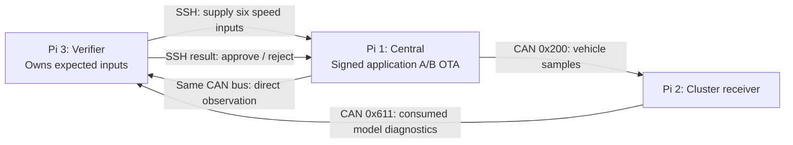

# Three-Pi CAN bench

## Roles and status



Three independently launchable roles and the remote OTA gate are implemented.
Tests currently use separate simulated bus endpoints with the actual candidate app
process. **A physical three-Pi CAN test has not been performed.** The earlier
single-Pi stdio demo remains available and unchanged by default.

The verifier has its own CAN socket, generates the expected inputs, observes the
Central frames directly, and reads consumption reports directly from Cluster. It
does not accept Central's claim that Cluster worked. Cluster diagnostic values are
still Cluster self-reports; this does not prove the Qt screen displayed them.
`cluster` implements a fixed headless receiver, not the existing Qt dashboard.

## More realistic incompatibility

V2 and Cluster use protection Data ID `0x21`. A V3 release accidentally packages
`0x22`, for example after importing the wrong communication configuration while
only updating one ECU. CAN identifier `0x200`, payload size and signal layout are
unchanged; both configurations initialize successfully. However the protection
checks no longer agree, so Cluster refuses all samples. Availability of valid data
is lost despite the app being alive and the image signature being valid.

The verifier supplies 40, 43, 47, 52, 58, 65 km/h. It requires six valid observed
frames and six matching accepted Cluster values under a fresh challenge; rejection
or missing/malformed evidence fails closed. This detects **configuration
incompatibility**, not an automatically discovered vulnerability.

Industrial basis: AUTOSAR E2E uses CRC, Data ID and counters to address communication
faults. See the [AUTOSAR E2E Protocol Specification, R22-11](https://www.autosar.org/fileadmin/standards/R22-11/FO/AUTOSAR_PRS_E2EProtocol.pdf),
section 6.5.1 on sender/receiver Data ID agreement and CRC calculation. This bench binds a two-byte Data ID to a
CRC-8/SMBUS over the existing seven payload bytes. **It is not a conforming AUTOSAR
profile**, and the proposed packaging error is our scenario, not a cited OEM event.

## Before running

All three hosts need this checkout at a known path, Python 3.10+, and the project
dependencies. Run from the checkout because `demo` is intentionally source-only.
Each needs a working classic SocketCAN `can0`, the same configured bitrate and a
properly wired/terminated isolated bench bus. Raspberry Pi alone has no CAN
transceiver; suitable CAN interfaces and their vendor setup are required.

No scripts here configure hardware, install drivers, reboot or replace services.
When hardware is ready, verify CAN interface configuration independently. On one
Linux machine, a preconfigured `vcan0` can exercise the real socket code by passing
`--channel vcan0` (and corresponding Central/Verifier channel flags).

SSH trust must be provisioned beforehand:

- Pi 1 can SSH to Pi 3; Pi 3 can SSH to Pi 1, using dedicated accounts/keys and pinned
  host keys. Commands use batch mode and strict host-key checking. No prompts or
  automatic host-key enrollment occur during an update.
- Use `~/.ssh/config` for identities and aliases `central-pi` and `verifier-pi`.
- Signing private keys stay on the laptop. Only the public update key reaches Pi 1.
- The example assumes checkout `/home/otauser/CAPSTONE_OTA`, a `.venv` inside it and
  device root `/home/otauser/can-bench-device`. Adjust paths to your actual hosts.

## Prepare signed releases on the laptop

Use the existing Ed25519 signing key; these commands do not create or print it.
Use fresh output paths on each run. Serve only the release directory, not keys.

```bash
python -m demo.can_bench pack --workspace .demo/can-payload-v2 \
  --output .demo/can-releases/v2 --version 2.0.0 --svn 2 \
  --data-id 0x21 --key /path/to/private-signing.key
python -m demo.can_bench pack --workspace .demo/can-payload-v3 \
  --output .demo/can-releases/v3 --version 3.0.0 --svn 2 \
  --data-id 0x22 --key /path/to/private-signing.key
python -m http.server 8000 --directory .demo/can-releases
```

V3 retains SVN 2 so that its failure is caused by ECU compatibility, not the
security-version floor. Use a new device root rather than mixing these Data-ID
protected payloads with the previous unprotected stdio packages.

## Pi 2: start the fixed Cluster receiver

```bash
cd /home/otauser/CAPSTONE_OTA
.venv/bin/python -m demo.can_bench cluster --channel can0
```

This is a foreground bench process. Stop it with Ctrl+C. It does not change the
existing dashboard service or systemd configuration.

## Pi 1: install with the third-Pi verification gate

```bash
cd /home/otauser/CAPSTONE_OTA
.venv/bin/python -m demo.can_bench update \
  --root /home/otauser/can-bench-device \
  --public-key /path/to/update.pub \
  --verifier-host verifier-pi \
  --verifier-dir /home/otauser/CAPSTONE_OTA \
  --verifier-python /home/otauser/CAPSTONE_OTA/.venv/bin/python \
  --central-host central-pi \
  --central-dir /home/otauser/CAPSTONE_OTA \
  --central-python /home/otauser/CAPSTONE_OTA/.venv/bin/python \
  http://LAPTOP_IP:8000/v2
```

Run the same command with `/v3` afterward; omit `--public-key` after first install.
Expected: V2 commits, V3 fails with `E2E_CONFIGURATION_INCOMPATIBLE`, and V2 is
rechecked through the third Pi before rollback completes. CLI exit 2 means rolled
back or an unsuccessful first installation; exit 1 means error or recovery failure. Omitting the URL performs interrupted
trial recovery through the same remote gate.

The gate temporarily selects the staged application, then executes its read-only
initialization check and calls Pi 3 over SSH. Pi 3 opens CAN and starts a fresh
diagnostic test, then uses SSH to make Pi 1 execute the selected actual payload and
send its output to CAN. The application slot is immutable; the receiver and oracle
are not shipped in the candidate package. Normal `ota update` does not invoke this
gate: use the explicit bench command above.

## Pi 3: optional manual verification

```bash
cd /home/otauser/CAPSTONE_OTA
.venv/bin/python -m demo.can_bench verify --channel can0 \
  --central-host central-pi --central-dir /home/otauser/CAPSTONE_OTA \
  --central-python /home/otauser/CAPSTONE_OTA/.venv/bin/python \
  --root /home/otauser/can-bench-device
```

## Diagnostic boundary and limits

- IDs `0x610/0x611` are dedicated bench diagnostics. Start carries a four-byte
  random challenge and `OTA!`; ACK echoes it. A report carries challenge, observed
  counter, consumed speed and accept flag. `65535` means no model value yet.
- The reset command starts a new controlled test session. This is not a diagnostic
  service to enable on a road vehicle. Only one verifier/test runs on this bus.
- Challenge matching correlates responses, not cryptographic CAN authentication.
  CRC likewise cannot stop a malicious sender forging messages. SSH protects the
  remote verdict transport; the Cluster and verifier software are trusted.
- After source completion, the verifier observes another 100 ms (within the overall
  deadline) to reject trailing extra samples or duplicate reports. This is a bounded
  bench observation window, not continuous runtime monitoring.
- Input-source speed generation is simulated. Physical sensors, timing/load tests,
  genuine ECU firmware and Qt pixels are outside this implementation.
- The existing V1-substitution demo is still `python -m demo.run`. Its rollback
  identity protection uses the same unchanged Device implementation. Automatic
  remote attack injection is not added to real hardware commands.
- App directory A/B only; OS A/B and service restoration after rejected recovery
  are intentionally deferred. Normal rollback to an intact V2 remains supported.

## Verification record — 2026-10-24

- Complete suite: **68 passed** (22.98 s), including the original OTA/slot-swap
  regressions and ten new CAN-role tests. New tests use simulated bus endpoints;
  they exercise the actual candidate application process and receive-side logic.
- Coverage includes matching/mismatching Data IDs, missing Cluster output, stale
  challenge, trailing extra evidence, and explicit remote-verdict/exit-status checks.
- Independent review found trailing extra evidence could be ignored; the new
  regression reproduced a false approval before the fix and passes after it.
- CLI help and absent `can0` were checked: missing hardware produces a negative
  verdict and exit 1. No CAN hardware, three-host SSH flow or Qt screen was tested.
- No changes to `capstone_ota/`, OS setup, existing Pi services or signing keys.
